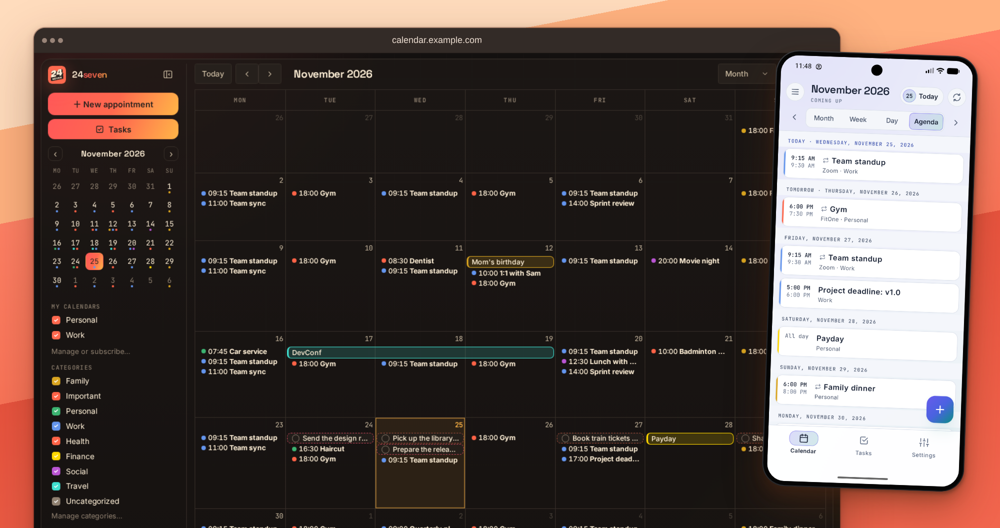
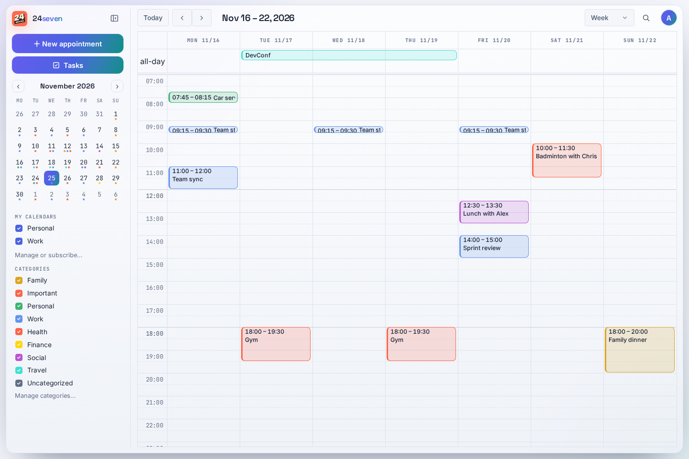
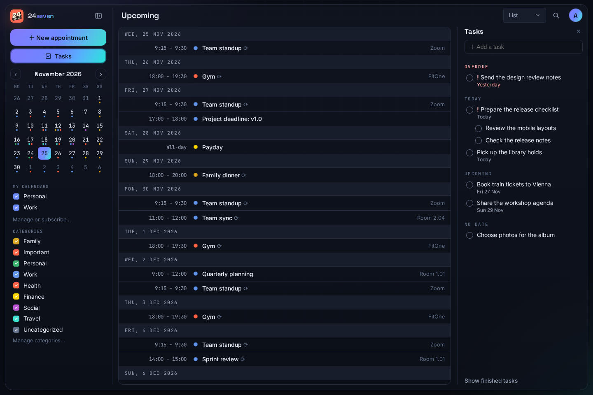
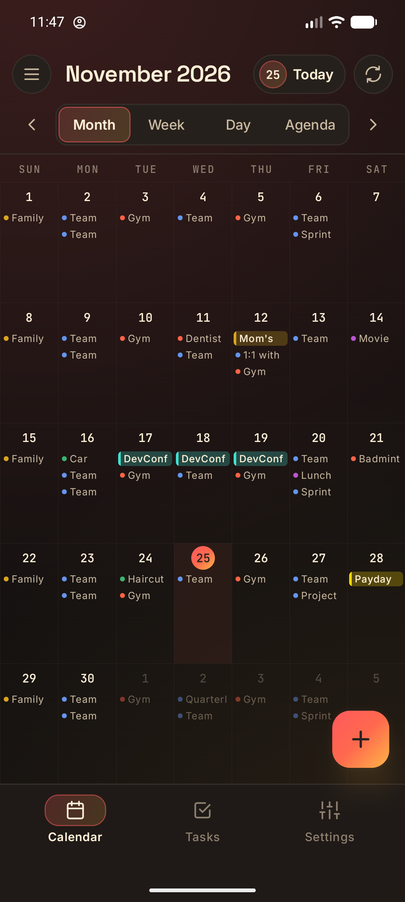
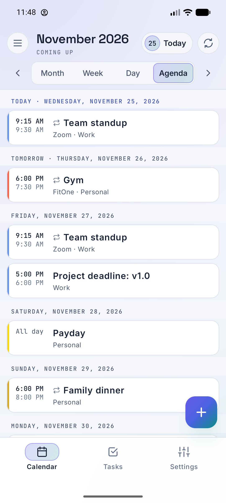
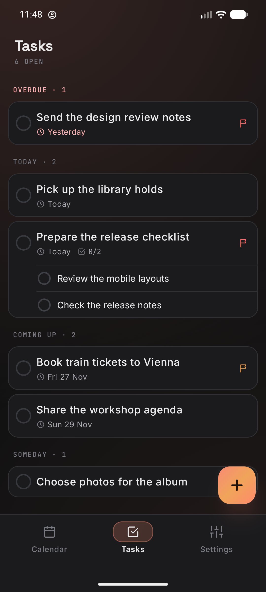

<p align="center">
  
</p>

<h1 align="center">24seven</h1>

<p align="center"><strong>A self-hosted calendar and task list for the web and Android.</strong><br />
Plan the week in your browser. Take it with you on your phone, even offline.</p>

<p align="center">
  <a href="#with-docker">Host with Docker</a> &nbsp;·&nbsp;
  <a href="#android-app">Android app</a> &nbsp;·&nbsp;
  <a href="#local-development">Demo data</a>
</p>

<picture>
  <source media="(max-width: 600px)" srcset="docs/readme-cover-compact.webp" />
  
</picture>

<p align="center"><sub>Full size &nbsp;·&nbsp; <a href="docs/screenshots/web-month-corner-store.png">Web month</a> &nbsp;·&nbsp; <a href="docs/screenshots/android-agenda-daylight.png">Android agenda</a></sub></p>

## In the browser

Drag across an open hour to book it. When plans move, drag the appointment to its new time or resize it, with undo a keystroke away. Switch to the agenda to see what's coming up and tick off the tasks due alongside it.

<table>
  <tr>
    <td width="50%" valign="top"><a href="docs/screenshots/web-week-daylight.png"></a><br /><b>Week</b> · Daylight</td>
    <td width="50%" valign="top"><a href="docs/screenshots/web-agenda-midnight.png"></a><br /><b>Agenda and tasks</b> · Midnight</td>
  </tr>
</table>

- **Recurring appointments.** Schedule every other Friday or the second Tuesday of each month. Reschedule a single occurrence, all future occurrences or the whole series. Each event keeps its own time zone through daylight-saving changes.
- **Shared plans.** Invite guests, track their replies and respond to invitations from the calendar. Connect your own mail account for invitations and email reminders, or choose a browser notification for a reminder.
- **Your other calendars.** Toggle Work and Personal independently, subscribe to a holiday feed, or import and export `.ics` files. CalDAV lets other clients sync appointments and tasks with your server.

## Android app

After the first sync, the native app keeps a copy of your events and tasks on the phone. Edit an appointment on the train, check off a subtask, and your changes sync when you're connected again.

<table>
  <tr>
    <td width="33%" valign="top"><a href="docs/screenshots/android-month-corner-store.png"></a><br /><b>Month</b> · Corner Store</td>
    <td width="33%" valign="top"><a href="docs/screenshots/android-agenda-daylight.png"></a><br /><b>Agenda</b> · Daylight</td>
    <td width="33%" valign="top"><a href="docs/screenshots/android-tasks-graphite.png"></a><br /><b>Tasks</b> · Graphite</td>
  </tr>
</table>

1. On **Android 14 or newer**, download the signed APK and open it on your phone. [Android release and checksum](https://github.com/Richy1989/24seven/releases/tag/24seven-v0.3.0)
2. Choose **24seven server**, enter your server's HTTPS address, and sign in with the same account you use on the web. The Docker build below includes the mobile sync API. The `v0.10.0` server predates it.
3. Open **Settings** to enable phone reminders or **Show in phone's calendar**. Add the month widget from your home screen's widget picker. For immediate updates between scheduled syncs, connect a UnifiedPush distributor such as ntfy.

## With Docker

From a checkout of `main`, the included Compose file builds the web app and API together and starts PostgreSQL. You'll need Docker Compose and an HTTPS reverse proxy for this setup.

1. Copy `.env.example` to `.env`. Set `POSTGRES_PASSWORD`, generate a `JWT_SIGNING_KEY` with `openssl rand -base64 48`, and set `PUBLIC_BASE_URL` to your public HTTPS address.
2. Run `docker compose up -d --build` from the repository root.
3. Attach your reverse proxy to the `calendarit-edge` Docker network and forward requests to `http://app:8080`. For a proxy running on the host, the Compose file also shows a loopback port mapping.
4. Open your HTTPS address and register your first account. To close sign-up afterward, set `DISABLE_REGISTRATION=true` in `.env` and run `docker compose up -d`.

The Compose file includes the network and volume declarations. Unraid users can install either the standard template or the version with Traefik labels. [Compose file](docker-compose.yml) · [Environment example](.env.example) · [Unraid](deploy/calendarit.unraid.xml) · [Unraid with Traefik](deploy/calendarit-traefik.unraid.xml)

<details>
<summary><strong>Try it locally with SQLite and one container</strong></summary>

From the repository root, set a signing key in a local environment file on first setup. Keep that file and the named volume when you recreate the container.

```bash
(umask 077 && echo "JWT_SIGNING_KEY=$(openssl rand -base64 48)" > secrets/24seven-local.env)
docker build -t 24seven-local .
docker run -d --name 24seven-local --env-file secrets/24seven-local.env \
  -e APPDATA_PATH=/appdata -v 24seven-data:/appdata \
  -p 127.0.0.1:8080:8080 24seven-local
```

Open <http://localhost:8080> to register and use the web app.

</details>

## Configuration

| Setting | Where to find it |
| --- | --- |
| Calendars and colors | In web **Settings**, create calendars and assign category colors. Recolor a category once to update all its appointments. |
| Email and reminders | In **Settings → Email**, connect SMTP for outgoing invitations and reminders, and IMAP for incoming invitations and replies. **Outgoing mail** shows queued messages and delivery errors. |
| Browser notifications | Enable **Browser** for a reminder and allow notifications in that browser. Web Push requires HTTPS or localhost. The server persists its generated keys in `APPDATA_PATH`. |
| Password recovery | Set `PUBLIC_BASE_URL` so **Forgot your password?** can generate a single-use link valid for two hours. The server sends it through the user's connected mail account. If that account is unavailable, the instance owner can find the link by searching `docker compose logs app` for `password-reset`. Treat those logs as sensitive. |
| Reverse proxy | Set `FORWARDED_PROXY_HOPS` to the number of proxies in front of the API. Use `1` for a single proxy in front of the Compose app, or `2` when that proxy fronts the bundled nginx image. |

For database selection, mail host policy, authentication limits, log levels, container user IDs and optional Web Push keys, see the commented [Compose file](docker-compose.yml) and [environment example](.env.example).

## Local development

Use the **.NET 10 SDK**, **Node.js 22.12+** and npm. From the repository root, start the API and web dev server together, then seed the running server from a second terminal.

| | Linux (Bash) | Windows (PowerShell 7) |
| --- | --- | --- |
| Start the app | `./deploy/dev.sh` | `./deploy/dev.ps1` |
| Load demo calendars and tasks | `./deploy/seed.sh` | `./deploy/seed.ps1` |

Open <http://localhost:5173> and sign in with the local demo account `test@test.com` / `Test1234#1234`. The seed creates the Work and Personal calendars shown above, including recurring events, timed appointments and subtasks. The API listens on port `5299`. To regenerate the TypeScript API client, run `npm run gen:api` from `web/` with the API running.

<details>
<summary><strong>Build the Android app from source</strong></summary>

Install JDK 21 and Android SDK Platform 37.2. Connect a phone with USB debugging enabled or start an emulator, then run the following from the repository root.

```bash
cd android
./gradlew :app:installFossDebug
```

On the emulator, enter `http://10.0.2.2:5299` as the server address to reach the local development API.

</details>

The web client uses React and Vite, the server uses ASP.NET Core, and the Android app uses Kotlin, Jetpack Compose and Room. For design decisions and the roadmap, see [the architecture notes](ARCHITECTURE.md).

## License and support

24seven is free to self-host and released under the [MIT license](LICENSE). If it makes your week easier, you can [buy Richy a coffee](https://buymeacoffee.com/spaceelephant).
